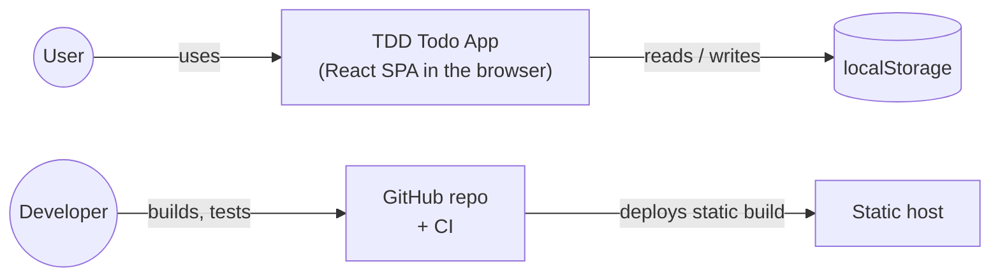
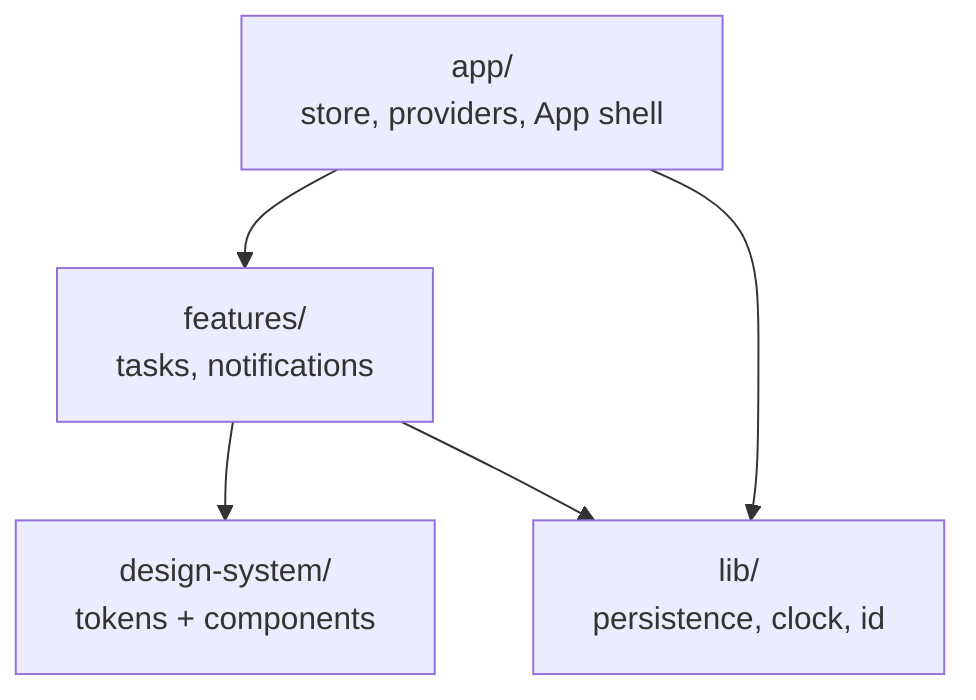
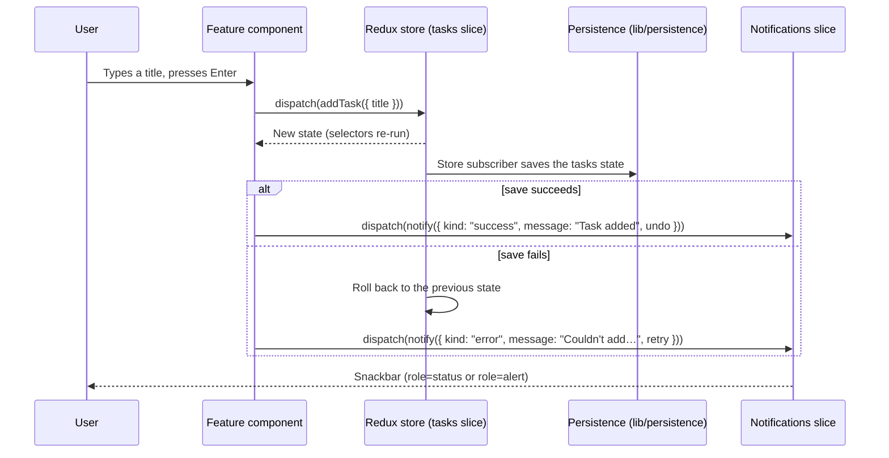

# Architecture overview

This document describes how the TDD Todo App is structured: its layers, data flow, state shape and the rules between them. It describes the **target architecture**. The [Current state vs target](#current-state-vs-target) section lists what still has to change in the code.

Related: [PRD](../product/PRD.md) · [ADRs](adr/) · [Testing strategy](../engineering/testing-strategy.md)

## 1. Context



- The app is a **single-page application** that runs entirely in the browser ([ADR-0002](adr/0002-frontend-only-with-localstorage.md)).
- There is **no backend and no network traffic** at runtime. Tasks are stored in `localStorage`.
- The build output is static files (HTML, JS, CSS) that any static host can serve.

## 2. Tech stack

| Concern | Choice | ADR |
|---|---|---|
| UI | React 19 + TypeScript (strict) | — |
| Build / dev server | Vite | — |
| State | Redux Toolkit + react-redux | [0003](adr/0003-redux-toolkit-for-state.md) |
| Unit, component, integration tests | Vitest + React Testing Library + user-event | [0004](adr/0004-vitest-and-testing-library.md) |
| End-to-end tests | Cypress | [0005](adr/0005-cypress-for-e2e.md) |
| Design system | In-repo, CSS custom properties (tokens) + React components, documented in Storybook | [0006](adr/0006-in-repo-design-system-with-css-tokens.md) |
| Design tool | Penpot | [0007](adr/0007-penpot-as-design-tool.md) |
| UX direction | Single list + details drawer (Option B) | [0008](adr/0008-list-and-drawer-ux.md) |
| Code organisation | Feature-based folders | [0009](adr/0009-feature-based-folder-structure.md) |

## 3. Layers and dependency rules



| Layer | Contains | May import from | Must not import from |
|---|---|---|---|
| `app/` | Store setup, typed hooks, providers, App shell and layout | `features/`, `design-system/`, `lib/` | — |
| `features/<name>/` | A slice, selectors, feature components (containers) and tests for one feature | `design-system/`, `lib/`, `app/hooks` | Other features' internals (use their public `index.ts`) |
| `design-system/` | Tokens, presentational components, stories | Nothing in the app | `app/`, `features/`, `lib/`, the Redux store |
| `lib/` | Framework-free helpers: the persistence adapter, clock, id generator | — | React, Redux, features |

These rules are enforced with ESLint `no-restricted-imports`, so a boundary violation fails lint.

## 4. Data flow



- **One-way flow:** components dispatch actions, reducers compute the next state, and components read state only through **memoized selectors**.
- **Side effects stay out of reducers.** Saving happens in one place, a store subscriber or listener middleware that calls the persistence adapter.
- **Undo** keeps the previous version of the changed task, so it can be restored.

## 5. State shape

```ts
interface RootState {
  tasks: {
    ids: string[];                      // newest first
    entities: Record<string, Task>;     // createEntityAdapter
    filter: 'all' | TaskStatus;
    selectedId: string | null;          // task open in the drawer
  };
  notifications: {
    queue: Array<{
      id: string;
      kind: 'success' | 'error';
      message: string;
      action?: 'undo' | 'retry';
    }>;
  };
}
```

`Task` and `TaskStatus` are defined in the [PRD data model](../product/PRD.md#6-data-model).

Key selectors:
- `selectVisibleTasks`: tasks filtered by the current filter.
- `selectCounts`: the count for each status, plus all.
- `selectSelectedTask`: the task open in the drawer.

## 6. Persistence

- **Adapter:** `lib/persistence` exposes a small interface:
  ```ts
  interface TaskStorage { load(): Task[] | null; save(tasks: Task[]): void }
  ```
- **Default implementation:** uses `localStorage` under a versioned key (`tdd-todo-app/v1`).
- **Corrupt or missing data:** `load()` returns `null` and the app starts with an empty list (US-13).
- **Save failures** (storage full or blocked) are thrown as errors and surfaced as error snackbars with Retry (US-2, 8, 12).
- **Testability:** the adapter is passed into the store setup, so tests use an in-memory fake, including one that fails on purpose.

## 7. Testability seams

These are the points where tests replace real dependencies, to keep every test deterministic:

| Seam | Production | In tests |
|---|---|---|
| Storage | `localStorage` adapter | In-memory fake (or a failing fake) |
| Clock | `() => new Date()` | Fixed date |
| Id generator | `crypto.randomUUID` | Sequential ids (`task-1`, `task-2`) |
| Store | `setupStore()` | `setupStore(preloadedState)` per test, via `renderWithProviders` |

## 8. Target folder structure

```
src/
  app/                  # store.ts, hooks.ts, App.tsx, providers
  design-system/        # tokens/, foundations/, components/, index.ts
  features/
    tasks/              # tasksSlice.ts, selectors.ts, components/ (TaskList, AddTask, TaskDrawer…), index.ts
    notifications/      # notificationsSlice.ts, Snackbars.tsx, index.ts
  lib/                  # persistence/, clock.ts, id.ts
  test/                 # test-utils (renderWithProviders, fakes, builders)
  main.tsx
```

## Current state vs target

| Area | Today | Target |
|---|---|---|
| State | No Redux yet | Redux Toolkit store with `tasks` and `notifications` slices (TDD-16, TDD-22) |
| Folders | `components/`, `containers/`, `pages/` (kanban layout) | `app/`, `features/`, `design-system/`, `lib/` ([ADR-0009](adr/0009-feature-based-folder-structure.md)) |
| Components | Button with the old MUI-like palette in `src/components/` | Option B components in `src/design-system/` (TDD-30, TDD-31) |
| Persistence | None | `lib/persistence` adapter (TDD-25) |
| E2E | Cypress config only, not installed | Cypress installed and running in CI (TDD-18, TDD-27) |
| CI | Removed | Lint, typecheck, tests and coverage as a required check (TDD-26) |
