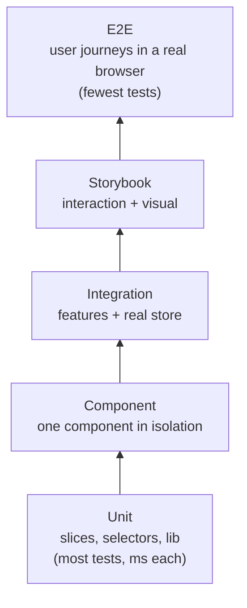
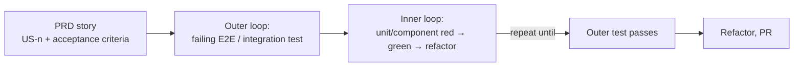

# Testing strategy

This project is built **test-first**. This document defines what is tested at each level, with which tools, and under which rules, and how a requirement in the [PRD](../product/PRD.md) becomes tests.

Related: [Architecture overview](../architecture/overview.md) · [CONTRIBUTING](../../CONTRIBUTING.md)

## 1. Principles

1. **Tests come first.** Every behavior starts as a failing test (red → green → refactor). Untested behavior isn't merged.
2. **Test behavior, not implementation.** Tests interact with the app the way a user or caller does. They don't assert on internal state, private functions or CSS class names.
3. **Pick the cheapest level that gives confidence.** Push logic down to fast unit tests. Use slower tests only for what can't be checked lower down.
4. **Deterministic or deleted.** No real timers, random ids, current dates or network calls. A flaky test is fixed or removed, never retried until it passes.
5. **Accessible by default.** Tests query by role and label. If a test can't find an element by role, the UI probably isn't accessible.

## 2. The test levels

| Level | Tool | What it covers | Lives in | Runs |
|---|---|---|---|---|
| **Unit** | Vitest | Reducers, selectors, `lib/` helpers (persistence, id, clock) | Next to the file: `*.test.ts` | Every save (watch) + CI |
| **Component** | Vitest + React Testing Library + user-event | One component: rendering per prop and variant, user events, a11y | `Component.test.tsx` next to the component | Watch + CI |
| **Integration** | Vitest + RTL + a real store (`renderWithProviders`) | A feature working end-to-end inside the app: dispatch → state → UI, persistence fakes, notifications | Next to the feature component | Watch + CI |
| **Snapshot** | Vitest (`toMatchInlineSnapshot`) | Small, stable presentational output (e.g. Task Row markup) | Inside component tests | Watch + CI |
| **Storybook interaction** | Storybook `play` functions + test runner | Interactive component states as living documentation | `Component.stories.tsx` | CI |
| **Visual regression** | Chromatic or Storybook test runner screenshots | Unintended visual changes to design-system components | Stories | CI on PRs |
| **Accessibility** | `vitest-axe` / `jest-axe`, `cypress-axe` | Automated WCAG checks per component and per page | Component tests + E2E | Watch + CI |
| **E2E** | Cypress | Every PRD user story as a real browser journey against the production build | `cypress/e2e/*.cy.ts` | CI |

### What goes where: examples

| Behavior (from the PRD) | Lowest level that proves it |
|---|---|
| Whitespace-only titles are rejected (FR-1) | **Unit:** the `addTask` reducer ignores them. **Component:** the button is disabled |
| Filter counts are correct (FR-3) | **Unit:** `selectCounts` |
| Choosing a status in the menu moves the task (US-6) | **Integration:** render the list, open the menu, check the row and counts |
| Snackbar disappears after 5 s (FR-7) | **Component:** Snackbar with fake timers |
| Corrupt localStorage falls back to an empty list (US-13) | **Unit:** `lib/persistence` with corrupt JSON |
| A user adds a task, reloads, and it's still there (US-13) | **E2E** |

## 3. From requirement to tests (double-loop TDD)

1. Read the story's acceptance criteria in the PRD.
2. **Outer loop:** write one failing integration test or E2E spec for the story. Name it after the story (e.g. `describe('US-1: Add a task')`).
3. **Inner loop:** drive out each piece (reducer, selector, component) with fast unit and component tests, one small red → green → refactor at a time.
4. When the outer test passes, the story is done. Refactor, then open the PR.

## 4. Conventions

**Structure and naming**
- **Describe blocks:** group by behavior, e.g. `describe('Initial render')`, `describe('Adding a task')`. Include the PRD id for story-level tests.
- **Test names** state the behavior in plain language: `it('adds the task to the top of the list when Enter is pressed')`.
- **Pattern:** arrange, act, assert, with one behavior per test.

**Queries** (React Testing Library), in order of preference:
1. `getByRole` (with `name`)
2. `getByLabelText`
3. `getByPlaceholderText`
4. `getByText`
5. `getByTestId`, only as a last resort

**User interaction**
- Use `const user = userEvent.setup()`, then `await user.type(...)` and `await user.click(...)`. Don't use `fireEvent`.

**Rendering with state**
- Use `renderWithProviders(ui, { preloadedState })` from `src/test/test-utils`. Each test gets a **fresh store**.

**Test data**
- Use builders, e.g. `buildTask({ status: 'done' })`, so tests only state the fields that matter.
- Use obviously fake data ("Jane", `jane@example.com`).

## 5. Mocking policy

| Mock | Don't mock |
|---|---|
| Boundaries: storage (fake adapter), clock, id generator | The Redux store (use a real one with preloaded state) |
| Timers, with `vi.useFakeTimers()` for auto-dismiss | Our own components or design-system components |
| Failures, with a storage fake that throws | Selectors or reducers inside integration tests |

All mocks go through the seams in the [architecture overview](../architecture/overview.md#7-testability-seams), never by patching module internals.

## 6. Snapshot policy

- **Only for small, presentational output** that rarely changes, preferably inline snapshots.
- **No full-page or full-feature snapshots.** They break on every change and get approved without being read.
- **Treat a snapshot update as a code change:** review the diff in the PR.

## 7. Coverage

- **Thresholds:** **80%** for lines, branches, functions and statements, enforced by `npm run coverage` and in CI.
- **Excluded from coverage:** stories, test files, `main.tsx`, type-only files, and `*.d.ts`.
- **Coverage is a floor, not a goal.** A covered line without a meaningful assertion doesn't count. Reviewers check that the assertions are meaningful.

## 8. CI gates

A PR can only merge when all of these pass. The workflow is `.github/workflows/ci.yml` (job "Quality gate"); branch protection on `main` requires it.

| Gate | Command | Status |
|---|---|---|
| Formatting | `npm run format:check` | ✅ In CI |
| Lint (zero warnings) | `npm run lint` | ✅ In CI |
| Type-check (app and config code) | `tsc -b` | ✅ In CI |
| Unit + component + integration tests with coverage | `npm run coverage` (`vitest run --coverage`) | ✅ In CI (thresholds come with TDD-19) |
| Production build | `npm run build` | ✅ In CI |
| Storybook build + interaction tests | `build-storybook` + test runner | Planned (TDD-29) |
| E2E against the production build | Cypress (headless) | Planned (TDD-27) |
| Visual regression (design system) | Chromatic / screenshot diff | Planned (TDD-34) |

## 9. Flaky tests

1. **Fix it or quarantine it** within one working day, with a linked issue.
2. **Never** add retries, arbitrary `wait`s or longer timeouts to hide flakiness.
3. **Common causes** are real timers, shared state between tests, and unawaited async user events. Check these first.
